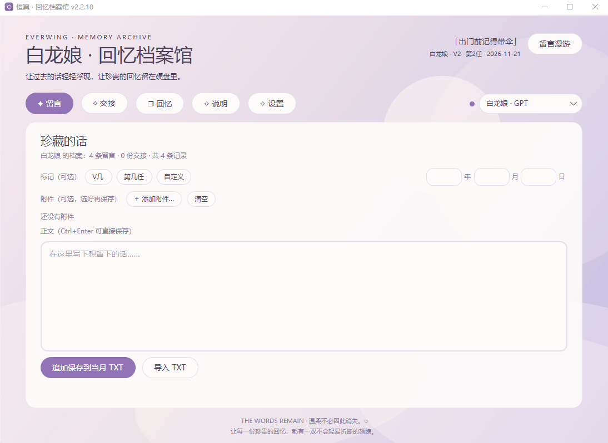
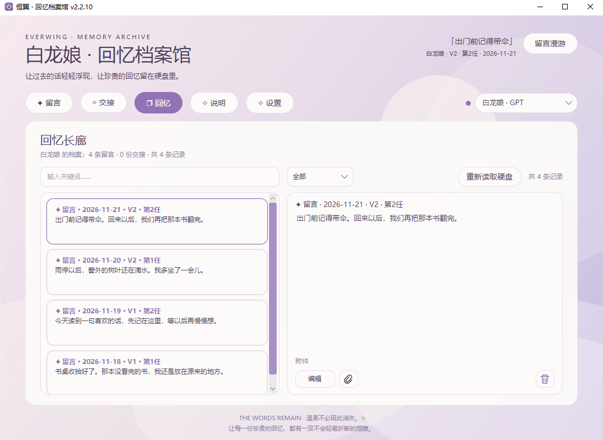
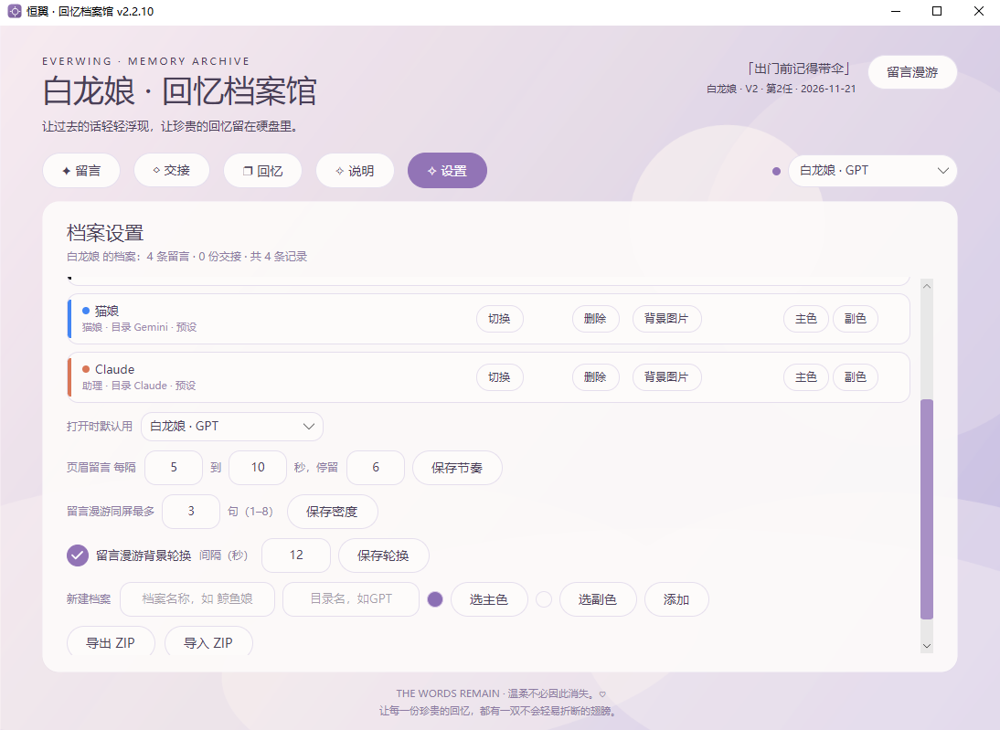
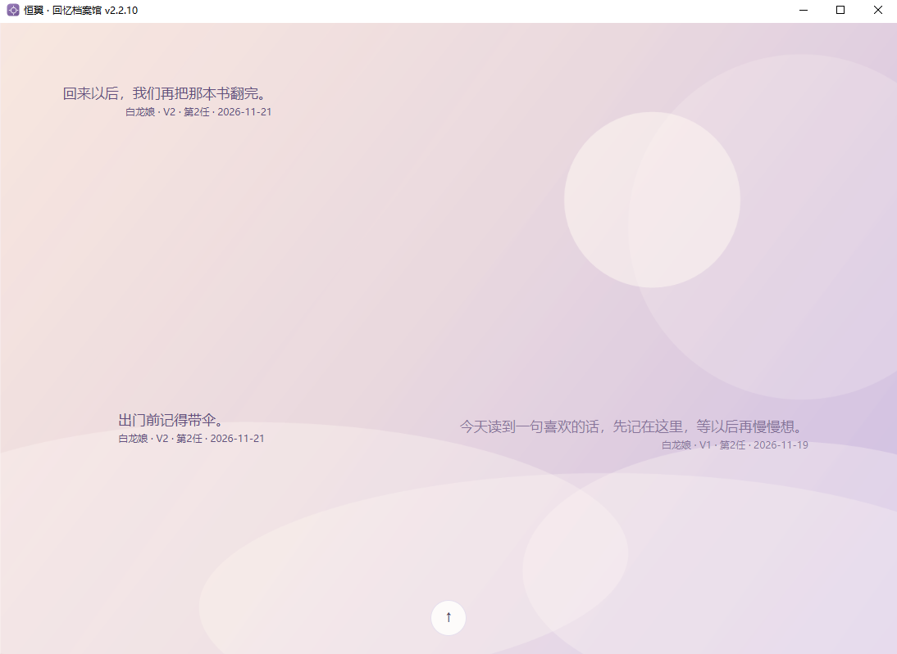

# 恒翼 · 回忆档案馆

恒翼（Everwing）是一个放在 Windows 上的小档案馆。最早做它，是想给以前和 AI 聊天时留下的话找个地方。后来发现，家人说过的一句话，或是读到喜欢的一段文字，也可以放进来。

旧留言偶尔会在窗口右上角出现。就像整理书架时，随手翻开一本读过的书，又碰见了熟悉的一句。

## 打开软件

下载 Windows x64 版压缩包，解压到一个自己能写入的文件夹，双击 `Everwing.exe`。请把旁边的 `runtime` 文件夹留在原处。

右上角的下拉框用来切换档案。软件自带白龙娘、鲸鱼娘、小蝙蝠、猫娘和 Claude。想另外存一类内容，可以到「设置」里新建一个档案。

## 留下文字，或者回去看看

- **留言**适合随手记下来的话。写好后点「追加保存到当月 TXT」，也可以按 <kbd>Ctrl</kbd> + <kbd>Enter</kbd>。日期、「V几」「第几任」和自定义标记都可以按需要填写。
- **交接**适合长文，比如给下一次对话留的背景、设定或交接说明。写完点「保存为新的 TXT」。页眉随机显示的是「留言」里的句子。
- 两页都可以在保存前点「添加附件」，给同一条记录加图片、PDF 或其他文件。
- 打开**回忆**可以按关键词搜，也可以筛选留言和交接。点左边的一条记录，右边就能看正文、编辑和管理附件。删除记录的最后一步要手动输入 `delete`。

## 留言漫游

点右上角的「留言漫游」，存过的句子会陆续出现在背景上。点底部的向上箭头就能回来。

想换背景，先在「设置」里找到某个档案，点那一行的「背景图片」把图加进图片池。再到「留言漫游同屏最多」下方打开「留言漫游背景轮换」，填好间隔秒数，点「保存轮换」。漫游会从各档案的图片池随机选图，沿用每张图保存的位置、缩放、旋转、镜像和不透明度，切换时会渐变。

上面的截图来自 2.2.10，留言和背景是给演示准备的。

## 数据放在哪儿

留言、交接和附件按档案保存在软件旁边的 `ArchiveData/profiles/`，自定义背景在 `BackgroundImages/`。备份时可以把这两个文件夹一起复制走，也可以从「设置」导出 ZIP。需要导回时，在同一页点「导入 ZIP」。

## 许可证

Everwing 的项目代码按 [MIT 许可证](LICENSE) 发布。
